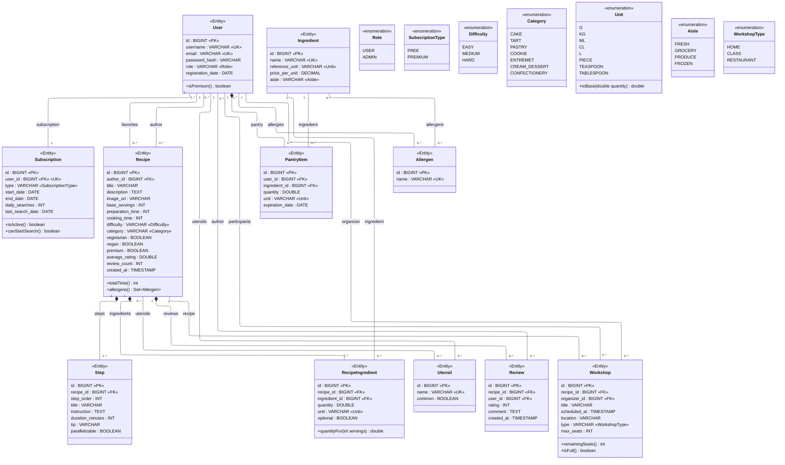
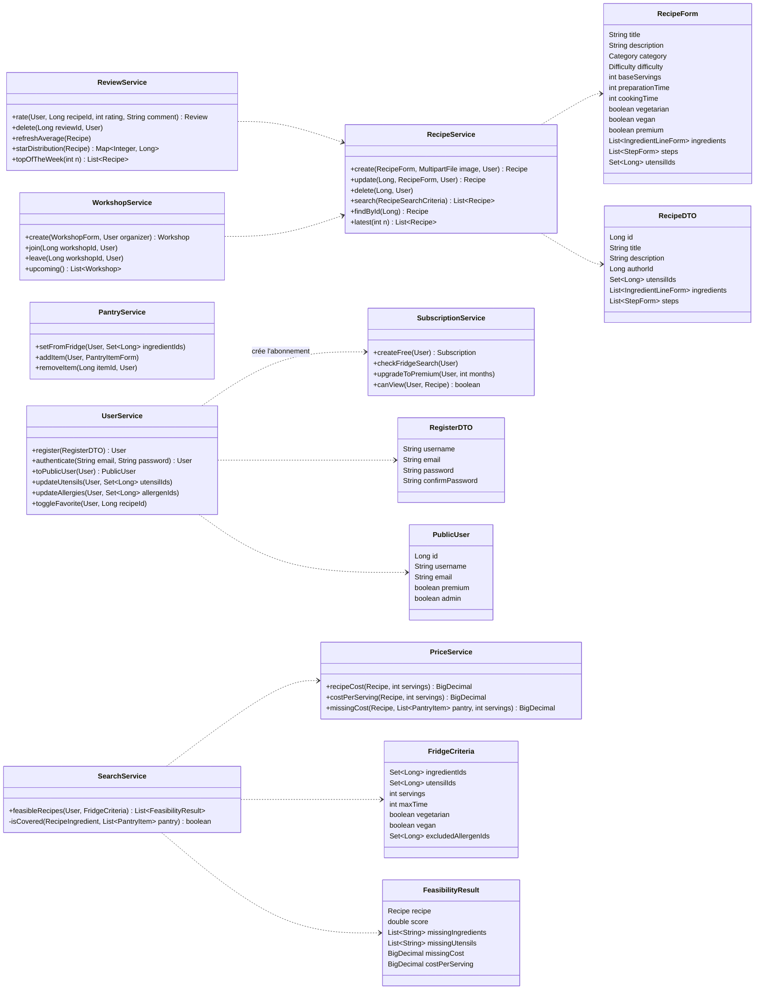
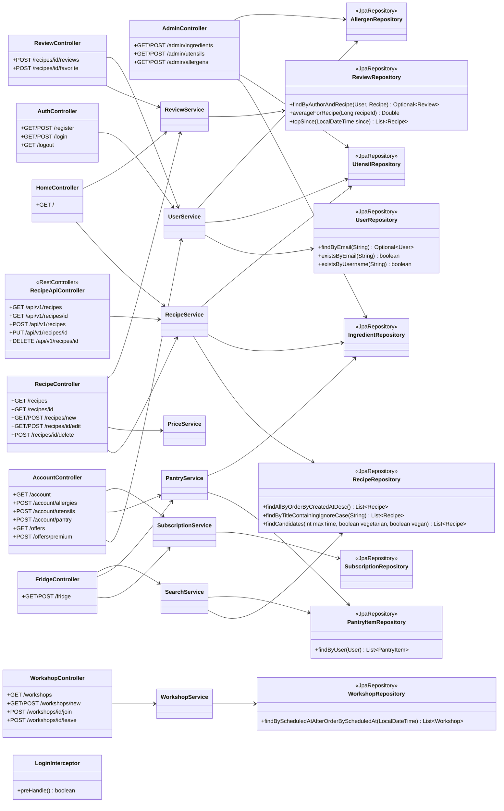
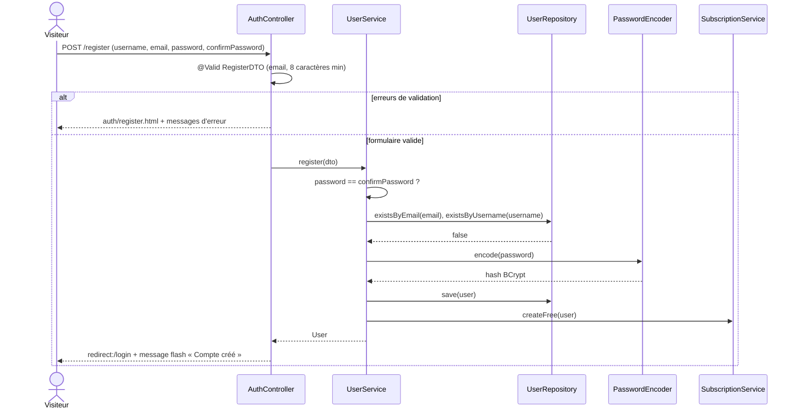
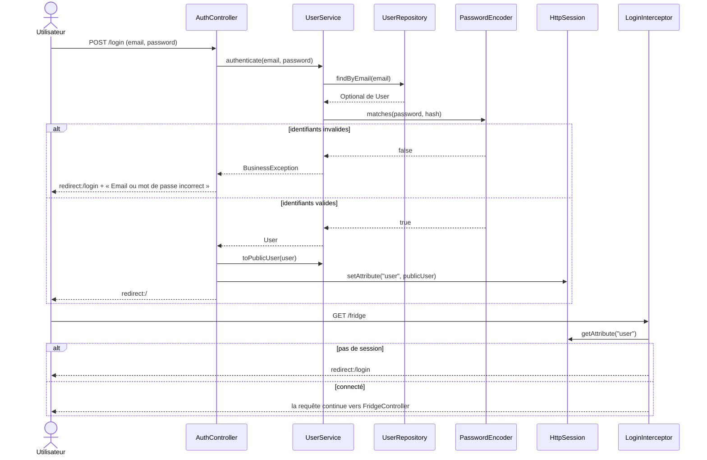
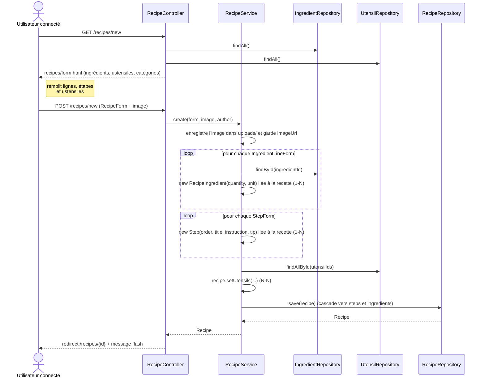
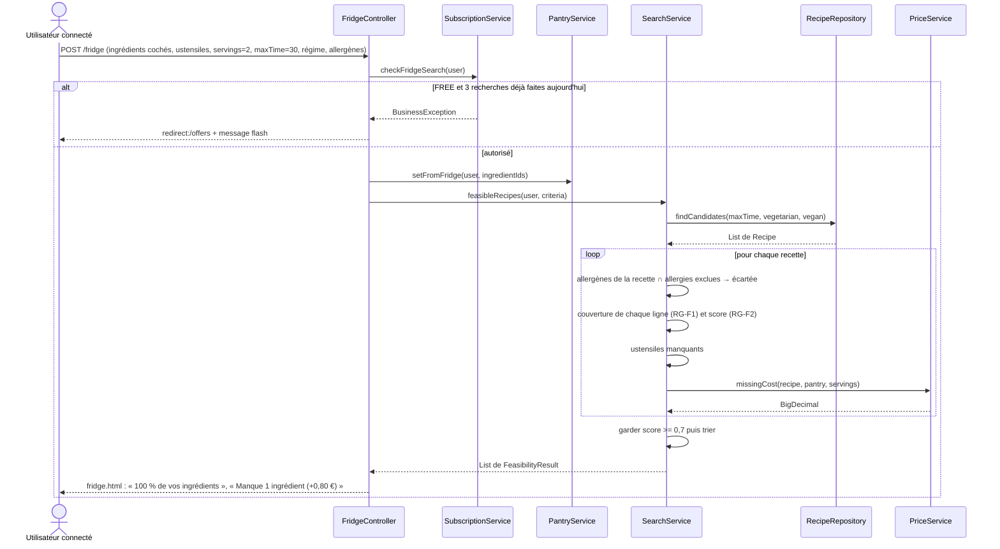
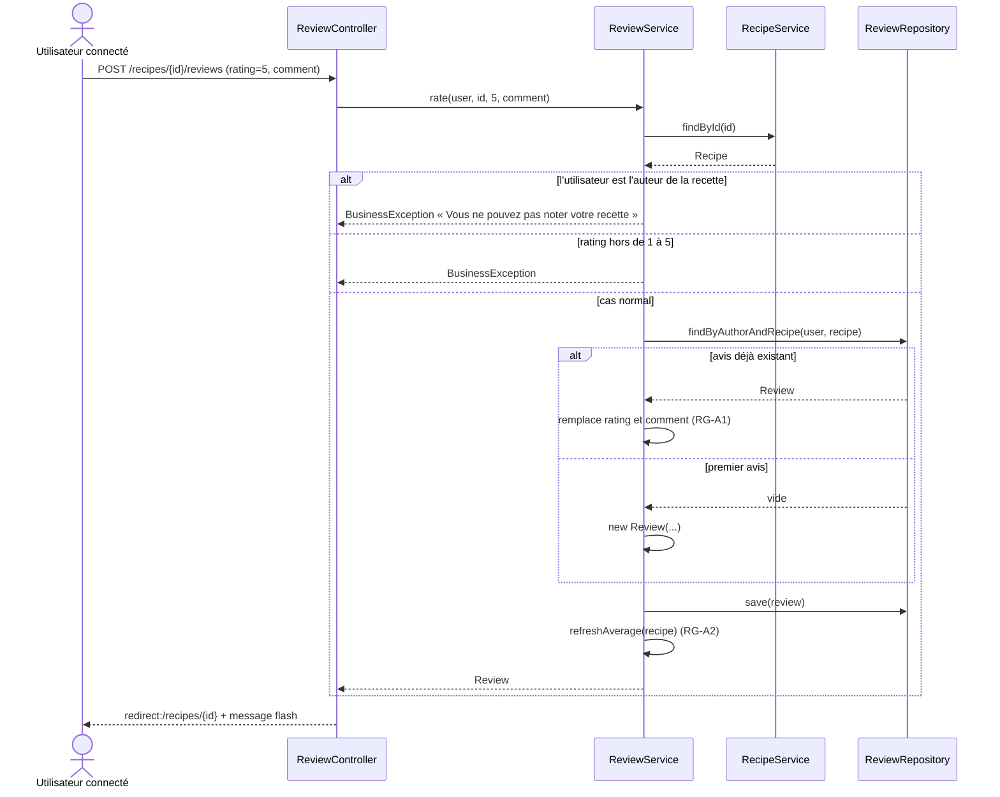
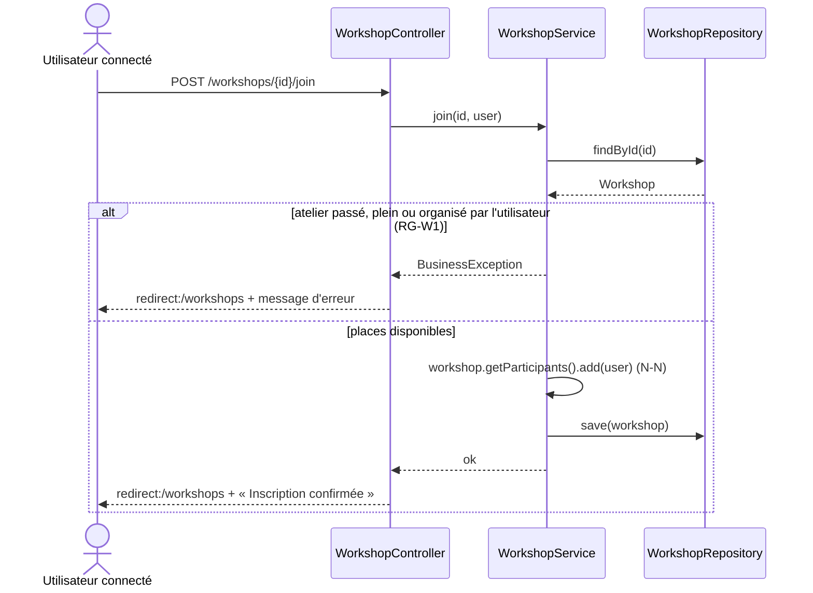
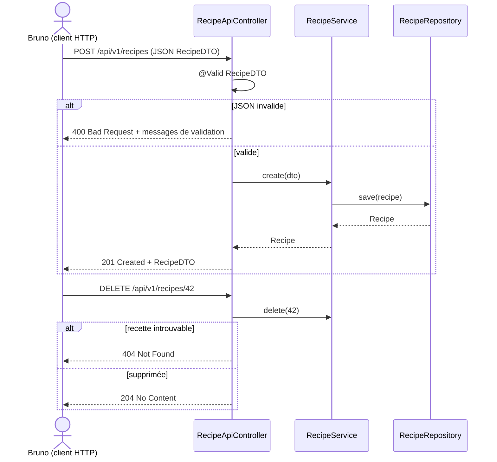

# Cookie App — Diagrammes UML

Version 2 (13/11/2026) : tout le code est en anglais (classes, attributs, colonnes, énumérations, routes), seuls les textes affichés à l'écran restent en français.
Elle reprend le diagramme de la branche `main` (`uml-cookie-app.md`) avec les corrections listées au paragraphe « Changements par rapport à la version de l'équipe ».
GitHub affiche les schémas directement ; pour modifier avec aperçu, collez un bloc dans [mermaid.live](https://mermaid.live).

| N° | Diagramme | Type |
| --- | --- | --- |
| 1 | Entités JPA et base de données | Classes |
| 2 | Services et DTO | Classes |
| 3 | Architecture MVC (controllers → services → repositories) | Classes |
| 4 | Inscription | Séquence |
| 5 | Connexion et page protégée | Séquence |
| 6 | Créer une recette (1-N et N-N) | Séquence |
| 7 | Frigo Magique | Séquence |
| 8 | Noter et commenter une recette | Séquence |
| 9 | S'inscrire à un atelier | Séquence |
| 10 | API REST depuis Bruno | Séquence |

## Notation

| Élément | Signification |
| --- | --- |
| `«Entity»` | Classe annotée `@Entity`, donc une table en base (nom de table = nom de classe en snake_case, sauf `User` → table `users`) |
| `«enumeration»` | Enum Java, stockée en `VARCHAR` via `@Enumerated(EnumType.STRING)` |
| `«PK»` / `«FK»` / `«UK»` | Clé primaire / clé étrangère / contrainte d'unicité |
| `«Role»`, `«Unit»`… sur une colonne | La colonne prend les valeurs de cette énumération |
| Losange plein (composition) | Les lignes filles sont supprimées avec le parent (`cascade = ALL, orphanRemoval = true`) |
| Libellé sur un lien | Nom de l'attribut Java de la relation (`author`, `favorites`…) |

## 1. Diagramme de classes des entités

### Méthodes métier des entités

| Méthode | Classe | Rôle |
| --- | --- | --- |
| `isPremium()` | User | Vrai si l'abonnement est `PREMIUM` et actif : décide l'accès aux recettes `premium`. |
| `isActive()` | Subscription | Vrai entre `start_date` et `end_date` (ou sans `end_date` pour `FREE`). |
| `canStartSearch()` | Subscription | Premium actif → toujours ; `FREE` → moins de 3 recherches Frigo aujourd'hui (`daily_searches`, remis à 0 quand `last_search_date` change). |
| `totalTime()` | Recipe | `preparation_time + cooking_time`, calculé pour ne jamais être incohérent. |
| `allergens()` | Recipe | Union des allergènes des ingrédients de la recette, pour avertir et filtrer. |
| `quantityFor(servings)` | RecipeIngredient | `quantity × servings / recipe.base_servings` : ajustement des portions. |
| `remainingSeats()`, `isFull()` | Workshop | `max_seats − participants.size()` ; plein quand il ne reste aucune place. |
| `toBase(quantity)` | Unit | Convertit en unité de base (g, ml ou pièce) : KG ×1000, CL ×10, L ×1000, TEASPOON = 5 ml, TABLESPOON = 15 ml. Sert au calcul du prix. |

### Relations et côté propriétaire

| Type | Relation (attribut Java) | Clé étrangère ou table de jointure | Associer / dissocier depuis |
| --- | --- | --- | --- |
| 1-1 | User ↔ Subscription (`subscription`) | `subscription.user_id` (unique) | Page Offres : passer Premium |
| 1-N | User → Recipe (`author`) | `recipe.author_id` | Création de recette (auteur = connecté) |
| 1-N | Recipe → Step (`steps`) | `step.recipe_id` | Formulaire recette : ajouter / supprimer une étape |
| 1-N | Recipe → RecipeIngredient → Ingredient | `recipe_ingredient.recipe_id`, `.ingredient_id` | Formulaire recette : lignes d'ingrédients |
| 1-N | User → PantryItem → Ingredient (`pantry`) | `pantry_item.user_id`, `.ingredient_id` | Frigo Magique / Mon garde-manger |
| 1-N | Recipe → Review, User → Review | `review.recipe_id`, `review.user_id` | Fiche recette : noter, commenter |
| 1-N | Recipe → Workshop, User → Workshop (`organizer`) | `workshop.recipe_id`, `.organizer_id` | Création d'atelier : choisir la recette |
| N-N | Recipe ↔ Utensil (`utensils`) | `recipe_utensil` | Formulaire recette : cocher les ustensiles |
| N-N | User ↔ Utensil (`utensils`) | `user_utensil` | Mon espace : mes équipements |
| N-N | User ↔ Allergen (`allergies`) | `user_allergen` | Mon espace : mes allergies |
| N-N | Ingredient ↔ Allergen (`allergens`) | `ingredient_allergen` | Admin : fiche ingrédient |
| N-N | User ↔ Recipe (`favorites`) | `favorite` | Bouton cœur |
| N-N | Workshop ↔ User (`participants`) | `workshop_participant` | S'inscrire / se désinscrire |

`RecipeIngredient` et `PantryItem` relient deux entités comme un N-N mais portent des données (quantité, unité) : ce sont des entités avec deux `@ManyToOne`, pas des `@ManyToMany`. Pour la grille, les vrais `@ManyToMany` sont les six de la fin du tableau.

### Règles de gestion

- **RG-U1** : `email` et `username` uniques ; mot de passe ≥ 8 caractères, stocké en BCrypt ; une `Subscription` `FREE` est créée à l'inscription.
- **RG-R1** : seul l'auteur (ou un `ADMIN`) modifie ou supprime une recette.
- **RG-A1** : un seul avis par couple (user, recipe) (`@UniqueConstraint`) ; un auteur ne note pas sa propre recette ; `rating` entre 1 et 5.
- **RG-A2** : `average_rating` et `review_count` sont recalculés par `ReviewService` à chaque ajout, modification ou suppression d'avis.
- **RG-F1** : une ligne est couverte si l'utilisateur a un `PantryItem` pour cet ingrédient (quantité vide = « j'en ai » ; quantité renseignée = il en faut assez, après `toBase`) ; une ligne `optional` ne compte pas.
- **RG-F2** : score = lignes couvertes / lignes non optionnelles ; on garde score ≥ 0,7, sans allergène de l'utilisateur ni ustensile manquant non `common` ; tri par score puis coût du complément.
- **RG-P1** : coût d'une ligne = `toBase(quantityFor(n)) × price_per_unit` (prix par unité de base de l'ingrédient) ; coût du complément = somme des lignes non couvertes.
- **RG-S1** : `FREE` = 3 recherches Frigo par jour ; `PREMIUM` = illimité + recettes `premium`. Passage Premium simulé (pas de paiement).
- **RG-W1** : inscription à un atelier refusée s'il est plein, passé, ou si l'utilisateur en est l'organisateur ; `max_seats` ≥ 1.

### Changements par rapport à la version de l'équipe

| Version de l'équipe | Version 2 | Pourquoi |
| --- | --- | --- |
| Classes et énumérations en français (`Utilisateur`, `Recette`, `Difficulte`…), colonnes en anglais | Tout en anglais (`User`, `Recipe`, `Difficulty`…) | Demande du prof, et la branche `bdd` a déjà commencé en anglais (`User`, `Allergen`, `Subscription`) |
| Table `utilisateur` | Entité `User` → `@Table(name = "users")` | `USER` est un mot réservé de H2 : sans ça, la table ne se crée pas |
| `image : BLOB` | `image_url : VARCHAR` (fichier dans `uploads/`) | Des images dans H2 gonflent le fichier de base qui doit être dans Git |
| `remaining_ai_credits` | `daily_searches` + `last_search_date` | Il n'y a pas d'IA dans le périmètre ; sans date, le quota ne se remettait jamais à zéro |
| Pas de régime sur `Recette` | `vegetarian`, `vegan` | Filtres « Végétarien » et « Régime » de la maquette (accueil, liste, Frigo) |
| `Etape` sans titre ni astuce | `title`, `tip` ajoutés | La fiche recette de la maquette affiche un titre et une « Astuce du Chef » par étape |
| `StockIngredient` | `PantryItem` (même contenu, `quantity`, `unit` et `expiration_date` facultatifs) | Nom anglais ; l'écran Frigo coche des ingrédients sans quantité |
| `Avis.date`, `Atelier.date` | `created_at`, `scheduled_at` | `date` est un nom de type SQL, source d'erreurs |
| Liens sans libellé | Libellés `author`, `favorites`, `participants`… | Deux liens User–Recipe et deux liens User–Workshop étaient indiscernables |
| `Unite` sur la ligne et sur l'ingrédient, sans conversion | `Unit.toBase()` | Nécessaire au calcul du prix quand la recette dit « 200 G » et l'ingrédient est vendu au « KG » |

## 2. Diagramme de classes des services et DTO

## 3. Architecture MVC : controllers, services, repositories

Chaque controller renvoie une vue Thymeleaf (sauf `RecipeApiController`, qui renvoie du JSON). `LoginInterceptor` protège `/fridge`, `/account/**`, `/offers/**`, `/recipes/new`, `/recipes/*/edit`, `/workshops/new`, `/workshops/*/join`, `/admin/**` (rôle `ADMIN`).

## 4. Séquence « Inscription »

## 5. Séquence « Connexion et page protégée »

## 6. Séquence « Créer une recette » (associations 1-N et N-N)

## 7. Séquence « Frigo Magique »

## 8. Séquence « Noter et commenter une recette »

## 9. Séquence « S'inscrire à un atelier »

## 10. Séquence « API REST : créer une recette depuis Bruno »

