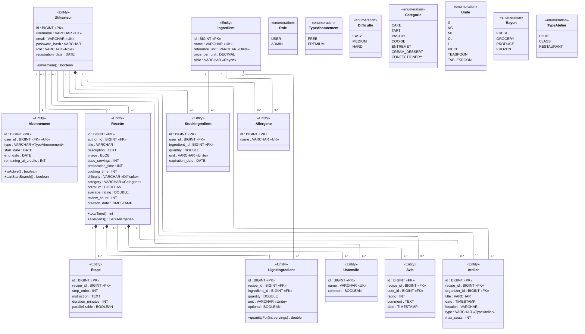

# Cookie App — Diagramme de classes UML (entités et base de données)

Diagramme de référence du projet : chaque classe est une entité JPA (`@Entity`) et une table de la base H2.
Le nom de la table est celui de l'entité en snake_case (`LigneIngredient` → `ligne_ingredient`), et les attributs portent le nom (en anglais) et le type des colonnes.

## Notation

| Élément | Signification |
|---|---|
| `«Entity»` | Classe annotée `@Entity`, donc une table en base |
| `«enumeration»` | Enum Java, stockée en `VARCHAR` via `@Enumerated(EnumType.STRING)` |
| `«PK»` / `«FK»` / `«UK»` | Clé primaire / clé étrangère / contrainte d'unicité |
| `«Role»`, `«Unite»`… sur une colonne | La colonne prend les valeurs de cette énumération |
| `"1"`, `"0..*"`… sur un lien | Cardinalités de la relation |
| Losange plein (composition) | Les lignes filles sont supprimées avec le parent (`cascade = ALL, orphanRemoval = true`) |
| `+method()` | Méthode métier de l'entité (voir [Méthodes](#méthodes)) |

## Diagramme

## Méthodes

Seules les méthodes qui portent une règle métier ou un calcul dérivé figurent sur le diagramme. Les getters/setters et les méthodes triviales sont omis.

| Méthode | Classe | Justification |
|---|---|---|
| `isPremium() : boolean` | Utilisateur | Règle d'accès centrale : décide si l'utilisateur peut ouvrir une recette `premium`. Elle s'appuie sur l'abonnement (type `PREMIUM` et actif), ce qui évite de dupliquer ce test dans chaque contrôleur. |
| `isActive() : boolean` | Abonnement | Un abonnement n'est valide qu'entre `start_date` et `end_date` : la règle de dates est encapsulée ici, et utilisée par `isPremium()`. |
| `canStartSearch() : boolean` | Abonnement | Vérifie le quota de recherche IA (`remaining_ai_credits` > 0, ou abonnement premium actif) avant de lancer une recherche. C'est une règle métier liée aux données de l'abonnement. |
| `totalTime() : int` | Recette | Valeur dérivée (`preparation_time + cooking_time`) affichée et utilisée pour filtrer : on la calcule au lieu de la stocker, pour qu'elle ne soit jamais incohérente. |
| `allergens() : Set<Allergene>` | Recette | Agrège les allergènes de tous les ingrédients via `LigneIngredient`. Indispensable pour avertir ou filtrer selon les allergies de l'utilisateur, sans table supplémentaire. |
| `quantityFor(int servings) : double` | LigneIngredient | Recalcule la quantité pour un nombre de personnes : `quantity × servings / base_servings` de la recette. Fonctionnalité visible (ajustement des portions) dont le calcul appartient à la ligne. |

Méthode écartée : `nbRecettesCreees()` (nombre de recettes créées) n'apporte rien au modèle : c'est la taille de la relation Utilisateur → Recette, déjà lisible via la cardinalité, ou un simple `COUNT` en requête.

## Relations

Les relations 1-N et N-N doivent pouvoir être associées et dissociées depuis l'interface (exigence du sujet).

| Type | Relation | Clé étrangère ou table de jointure | Association graphique |
|---|---|---|---|
| 1-1 | Utilisateur ↔ Abonnement | `abonnement.user_id` (unique) | Page « Mon compte » : passer premium / revenir gratuit |
| 1-N | Utilisateur → Recette (auteur) | `recette.author_id` | Admin : réattribuer une recette |
| 1-N | Recette → Etape | `etape.recipe_id` | Éditeur de recette : ajouter, supprimer, réordonner |
| 1-N | Recette → LigneIngredient → Ingredient | `ligne_ingredient.recipe_id`, `ligne_ingredient.ingredient_id` | Éditeur de recette : ingrédients et quantités |
| 1-N | Utilisateur → StockIngredient → Ingredient | `stock_ingredient.user_id`, `stock_ingredient.ingredient_id` | Page « Mon garde-manger » |
| 1-N | Recette → Avis, Utilisateur → Avis | `avis.recipe_id`, `avis.user_id` | Fiche recette : noter, commenter |
| 1-N | Recette → Atelier, Utilisateur → Atelier (organisateur) | `atelier.recipe_id`, `atelier.organizer_id` | Création d'atelier : choisir la recette |
| N-N | Recette ↔ Ustensile | `recette_ustensile` | Éditeur de recette : cocher les ustensiles |
| N-N | Utilisateur ↔ Ustensile | `utilisateur_ustensile` | Page « Ma cuisine » : mes équipements |
| N-N | Utilisateur ↔ Allergene | `utilisateur_allergene` | Page « Ma cuisine » : mes allergies |
| N-N | Ingredient ↔ Allergene | `ingredient_allergene` | Admin : fiche ingrédient |
| N-N | Utilisateur ↔ Recette (favoris) | `favori` | Bouton cœur sur la fiche recette |
| N-N | Atelier ↔ Utilisateur (participants) | `atelier_participant` | S'inscrire / se désinscrire |

`LigneIngredient` et `StockIngredient` relient deux entités comme un N-N, mais portent des données (quantité, unité) : ce sont donc des entités à part entière avec deux `@ManyToOne`, et non des `@ManyToMany`.

## Contraintes non visibles sur le diagramme

- `avis` : unicité sur `(recipe_id, user_id)` (un seul avis par utilisateur et par recette), `rating` comprise entre 1 et 5.
- `abonnement.user_id` est unique, ce qui garantit la relation 1-1.
- `recette.average_rating` et `recette.review_count` sont dénormalisés et recalculés à chaque ajout, modification ou suppression d'avis.
- `atelier.max_seats` ≥ 1 ; le nombre de lignes dans `atelier_participant` pour un atelier ne doit pas le dépasser.

## Modifier le diagramme

Collez le bloc Mermaid sur https://mermaid.live, ou laissez-le dans ce fichier : GitHub et la plupart des éditeurs Markdown l'affichent directement.
La ligne `layout: elk` de l'en-tête donne un tracé à angles droits plus lisible ; si votre éditeur ne la prend pas en charge, supprimez-la.
